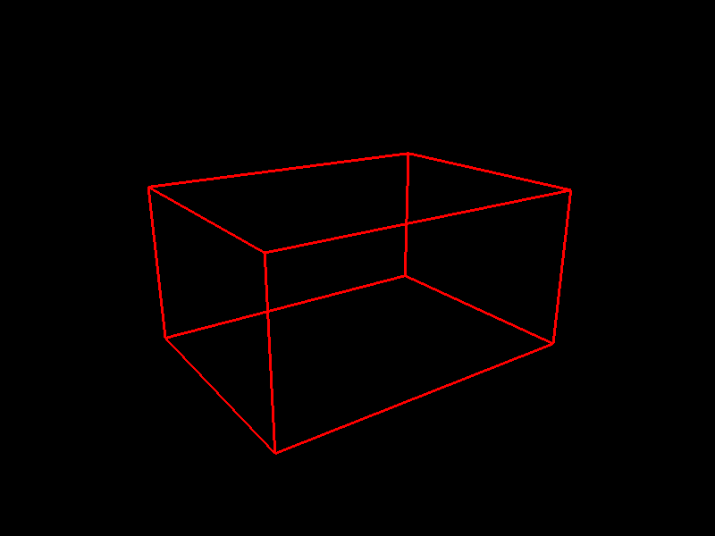

# Lab 04: 3D Wireframe Modeling and Transformation using OpenGL

Course Code: IRE 404  
Course Title: Computer Graphics and Animation Sessional  
Department: Department of Internet of Things and Robotics Engineering (IRE)  
Faculty: Faculty of Cyber Physical System Engineering  
Institution: University of Frontier Technology, Bangladesh (UFTB)  

Author: Shahriar Alom Masud  
Student ID: 2201032  
Session: 2022-2023  
Instructor: Farzana Akter, Assistant Professor, Dept. of IRE, UFTB  

---

## Problem Statement & Objectives

Construct, render, and animate a 3D wireframe rectangular cuboid using Pygame and PyOpenGL. The object must exhibit mutually distinct dimensions across the principal axes ($W \neq H \neq D$) and continuously rotate around the Cartesian $Y$-axis.

### Requirements Checklist:
1. **Window Resolution**: $800 \times 600$ pixels via `pygame.display.set_mode()`.
2. **Background Color**: Solid black canvas using `glClearColor(0.0, 0.0, 0.0, 1.0)`.
3. **Edge Color**: Red wireframe edges using `glColor3f(1.0, 0.0, 0.0)`.
4. **Edge Thickness**: 3 pixels wide using `glLineWidth(3.0)`.
5. **Modified Dimensions**: Unequal width, height, and depth ($W = 4.0, H = 2.0, D = 3.0$).
6. **Continuous Rotation**: Continuous rotation around the $Y$-axis using `glRotatef()`.
7. **Animation Verification**: Smooth 60 FPS rotation against the black canvas.

---

## Theoretical & Mathematical Basis

### 1. Cuboid Geometric Modeling
To enforce $W \neq H \neq D$, half-extents are chosen as:
- $\text{Half Width } (w_x) = 2.0 \implies \text{Total Width } (X) = 4.0$
- $\text{Half Height } (h_y) = 1.0 \implies \text{Total Height } (Y) = 2.0$
- $\text{Half Depth } (d_z) = 1.5 \implies \text{Total Depth } (Z) = 3.0$

The 8 symmetric vertices are defined as $(\pm 2.0, \pm 1.0, \pm 1.5)$ and rendered using 12 line segments (`GL_LINES`).

### 2. $Y$-Axis Rotation Matrix
$$\mathbf{R}_y(\theta) = \begin{bmatrix}
\cos\theta & 0 & \sin\theta & 0 \\
0 & 1 & 0 & 0 \\
-\sin\theta & 0 & \cos\theta & 0 \\
0 & 0 & 0 & 1
\end{bmatrix}$$
Calling `glRotatef(1.0, 0.0, 1.0, 0.0)` increments the rotation angle each frame.

---

## Output Visualizations

| Angle $\theta = 0^\circ$ | Angle $\theta = 35^\circ$ |
| :---: | :---: |
|  |  |

| Angle $\theta = 70^\circ$ | Angle $\theta = 120^\circ$ |
| :---: | :---: |
|  |  |

---

## Project Structure

```text
Lab_04/
├── cuboid.py                     # Main interactive OpenGL rotating cuboid script
├── capture_screenshots.py        # Automated multi-angle screenshot capture utility
├── screenshots/                  # Rendered output frames (0°, 35°, 70°, 120°)
│   ├── cuboid_angle_0.png
│   ├── cuboid_angle_35.png
│   ├── cuboid_angle_70.png
│   ├── cuboid_angle_120.png
│   └── cuboid_output.png
├── submission_report/            # Academic LaTeX submission report
│   ├── build.sh                  # 1-click PDF compilation script
│   ├── main.tex                  # Full LaTeX document source
│   ├── 2201032_Report_4.pdf      # Compiled formal lab report PDF
│   └── screenshots/              # Report assets and university crest
└── README.md                     # Lab 04 documentation
```

---

## Running the Code & Building the Report

### 1. Run Interactive OpenGL Program
```bash
python3 cuboid.py
```
> Press `ESC` or close the window to exit.

### 2. Compile Lab Report PDF
```bash
cd submission_report
./build.sh
```
The compiled submission report will be generated at:
`submission_report/2201032_Report_4.pdf`
