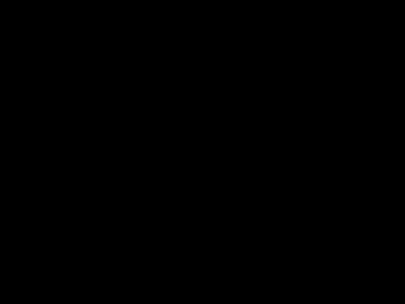
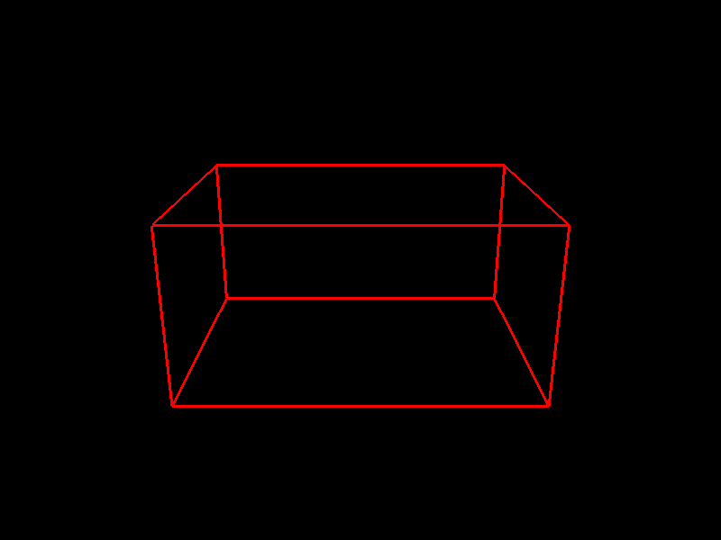

# Lab 04: 3D Wireframe Cuboid and Rotation using OpenGL

Course Code: IRE 404  
Course Title: Computer Graphics and Animation Sessional  
Department: Department of Internet of Things and Robotics Engineering (IRE)  
Faculty: Faculty of Cyber Physical System Engineering  
Institution: University of Frontier Technology, Bangladesh (UFTB)  

Author: Shahriar Alom Masud  
Student ID: 2201032  
Session: 2022-2023  
Instructor: Farzana Akter, Assistant Professor, Dept. of IRE, UFTB  

---

## Problem Description & Objectives

The goal of this lab is to create a 3D wireframe rectangular cuboid using Python, Pygame, and OpenGL. The cuboid has different dimensions for width, height, and depth ($W \neq H \neq D$). Its edges are drawn in red with a 3-pixel thickness and it rotates continuously around the Y-axis against a solid black background.

### Requirements:
1. **Window Resolution**: $800 \times 600$ pixels via `pygame.display.set_mode()`.
2. **Background Color**: Solid black using `glClearColor(0.0, 0.0, 0.0, 1.0)`.
3. **Edge Color**: Red wireframe edges using `glColor3f(1.0, 0.0, 0.0)`.
4. **Edge Thickness**: 3 pixels wide using `glLineWidth(3.0)`.
5. **Dimensions**: Distinct width, height, and depth ($W = 4.0, H = 2.0, D = 3.0$).
6. **Continuous Rotation**: Continuous rotation around the Y-axis using `glRotatef()`.
7. **Animation**: Smooth 60 FPS rotation on black background.

---

## Dimensions and Rotation

- **Width ($X$)**: $4.0$ (from $-2.0$ to $+2.0$)
- **Height ($Y$)**: $2.0$ (from $-1.0$ to $+1.0$)
- **Depth ($Z$)**: $3.0$ (from $-1.5$ to $+1.5$)
- **Rotation**: In the main loop, `glRotatef(1.0, 0.0, 1.0, 0.0)` rotates the object by 1 degree per frame around the Y-axis.

---

## Output Visualizations

| Front View ($\theta = 0^\circ$) | Rotating View ($\theta = 35^\circ$) |
| :---: | :---: |
|  |  |

| Side-Angled View ($\theta = 70^\circ$) | Side View ($\theta = 120^\circ$) |
| :---: | :---: |
|  |  |

---

## Project Structure

```text
Lab_04/
├── cuboid.py                     # Main Python OpenGL script
├── capture_screenshots.py        # Screenshot capture utility
├── screenshots/                  # Output screenshots (0°, 35°, 70°, 120°)
│   ├── cuboid_angle_0.png
│   ├── cuboid_angle_35.png
│   ├── cuboid_angle_70.png
│   ├── cuboid_angle_120.png
│   └── cuboid_output.png
├── submission_report/            # Lab report files
│   ├── build.sh                  # PDF build script
│   ├── main.tex                  # LaTeX source code
│   ├── 2201032_Report_4.pdf      # Compiled lab report PDF
│   └── screenshots/              # Report images and university crest
└── README.md                     # Documentation
```

---

## How to Run

### 1. Run the OpenGL Program
```bash
python3 cuboid.py
```
> Press `ESC` or close the window to exit.

### 2. Build the PDF Report
```bash
cd submission_report
./build.sh
```
Report will be compiled at: `submission_report/2201032_Report_4.pdf`.
